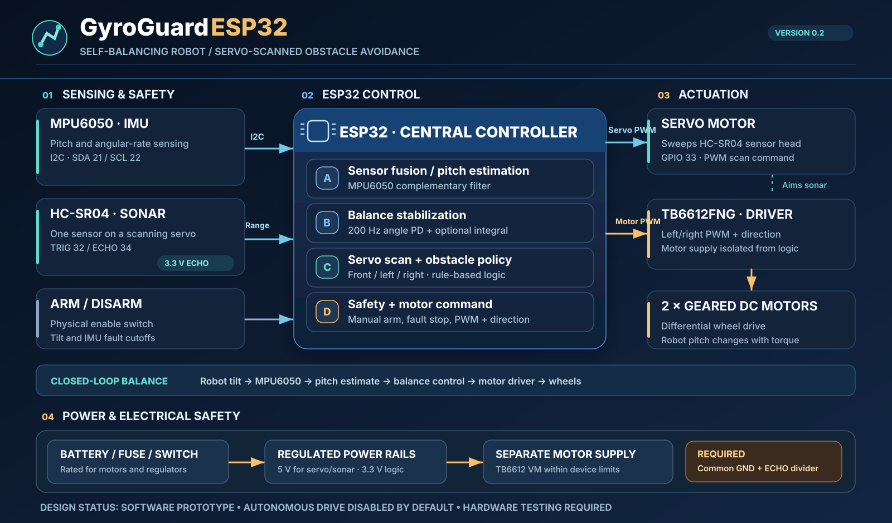

# GyroGuard ESP32 — Self-Balancing Robot + Obstacle Avoidance

**Status: V0.2 software prototype; NO hardware validation, not ready for autonomous deployment.**

ESP32-WROOM-32 prototype with an MPU6050 IMU, TB6612FNG dual motor driver, two DC geared motors and **one HC-SR04 ultrasonic sensor mounted on a servo**. The design separates the inner balance loop from a conservative navigation policy. Source includes host-runnable controller tests and wiring/commissioning documentation.

## System architecture

The diagram shows the **MPU6050 → ESP32 stabilization loop**, the **single HC-SR04 sensor mounted on a scanning servo**, and the **TB6612FNG driving the left/right motors**, together with manual arming and power distribution. It is a design schematic, not evidence of hardware validation. The controller uses a complementary pitch filter and a 200 Hz angle controller; obstacle avoidance is a conservative, rule-based prototype and is **disabled by default**.

## Implemented

- 200 Hz polled balance loop with MPU6050 gyro offset calibration (rejecting clearly moving/noisy startup samples), complementary pitch filter and angle PD control with optional I term.
- Two-direction TB6612FNG motor control at 20 kHz PWM, startup-off `STBY`, physical arm/disarm button, tilt/IMU/deadline cutoffs.
- One interrupt-timed HC-SR04 and PWM servo scanning front/left/right only when a near-front obstacle appears. The 200 Hz balance loop is never blocked waiting for servo movement or ECHO; stale readings invalidate navigation.
- Conservative rule-based obstacle navigation: stop/turn toward the open side near an obstacle; slow in intermediate range; steer away from close side walls. **Default disabled**, as autonomous motion needs closed-loop wheel velocity feedback.
- Host tests for controller sign, saturation, sensor failures, servo-scan sequencing, fresh/stale directional snapshots, obstacle turns and hysteresis.

This is **not TinyML or an AI-trained model**. TinyML is a future optional phase, once real obstacle and motion data have been gathered and a baseline has been validated.

## Requirements

- Classic ESP32-WROOM-32 development board (PlatformIO `esp32dev`)
- MPU6050 (AD0=GND), TB6612FNG, 2 DC geared motors, 1 HC-SR04 + 1 hobby servo (e.g. SG90), arm button
- Suitable battery/regulator, mechanical chassis, common ground, 5V-to-3.3V ECHO level shifting, electrical protection

See [pinout and electrical warnings](docs/PINOUT.md), then [commissioning checklist](docs/COMMISSIONING.md).

## Build and test

1. Install VS Code + PlatformIO, open this directory.
2. Upload: `pio run -t upload` (set correct serial port as needed).
3. View telemetry: `pio device monitor -b 115200`.
4. Run C++ host unit tests (Linux/macOS with g++): `bash test/host/run_tests.sh`.

The project pins the **official PlatformIO Espressif32 6.12.0** (Arduino-ESP32 2.0.x) because its `ledcSetup/ledcAttachPin` API is different from Arduino-ESP32 3.x. Do not silently bump the framework without migrating PWM calls.

## Control flow

`MPU6050 -> pitch complementary filter -> 200 Hz angle controller -> TB6612 -> wheels`

`HC-SR04 mounted on servo -> front/left/right scan scheduler -> obstacle policy -> bounded drive/turn intent -> balance controller`

By default `GYROGUARD_AUTONOMY=0` in `platformio.ini`. `GYROGUARD_AUTONOMY=1` enables experimental navigation **only after safe hardware validation**. Motor sign, mount orientation, controller gains and motor PWM cap are in `include/Config.h` and `lib/GyroCore/src/GyroCore.h`.

## Continuous integration and fault hardening

- **Host tests:** `.github/workflows/host-tests.yml` runs C++ controller, navigation, servo scheduler, and Arduino-interface syntax checks.
- **ESP32 compile check:** `.github/workflows/firmware-build.yml` compiles classic ESP32 firmware with PlatformIO Core 6.1.18 and pinned `espressif32 @ 6.12.0`; it does **not** flash or test physical hardware.
- Navigation control now refuses non-finite drive and turn intent rather than propagating invalid values through the balance controller. The sonar ISR latches the first completed ECHO pulse to reject later spurious edges before the main loop consumes it.
- **Important:** Hardware power cutoff, motor polarity, stable upright control and encoder-based velocity regulation still require verification before autonomous driving.

### Startup calibration safety

Gyro bias calibration now rejects large rotation (>15 deg/s per sample), large average offset (>5 deg/s), and noisy sample sequences (>2 deg/s standard deviation). Failure keeps IMU initialization invalid and prevents arming. This is a software safeguard, **not a certified motion detector**: hold the chassis upright and still at power-up, and verify the thresholds on real sensor data before revising them.

## Roadmap

1. **Bench validation:** hardware wiring, PWM polarity, IMU pitch direction, sensor range tests, fail-stop behavior.
2. **Balance tuning:** fit Kp/Kd to measured geometry and motor behavior; verify timing jitter.
3. **Add motor encoders + velocity PID:** reliable upright position hold, commanded forward speed and safer turns.
4. **Nav validation:** timed test course, side obstacle robustness, fault injection, collision metrics.
5. **Optional TinyML:** collect labeled sonar/odometry data, train and evaluate offline, quantize/measure inference latency vs 200 Hz budget.

## References

- Espressif [ESP32 datasheet](https://documentation.espressif.com/esp32_datasheet_en.html) and [GPIO rules](https://docs.espressif.com/projects/esp-idf/en/release-v5.5/esp32/api-reference/peripherals/gpio.html).
- PlatformIO [Espressif32 release 6.12.0](https://github.com/platformio/platform-espressif32/releases/tag/v6.12.0).
- Espressif [Arduino PWM API migration](https://docs.espressif.com/projects/arduino-esp32/en/latest/migration_guides/2.x_to_3.0.html).

## Single-servo sonar scan design (V0.2)

- Keep HC-SR04 facing **front at 90°** for frequent forward distance readings.
- If valid front distance is below 50 cm, suspend autonomous motion intent and swing the servo to **left 135°**, then **right 45°**, then back to **front 90°**.
- Wait for the servo to settle at each angle and trigger the HC-SR04 at least 65 ms apart. Sonar echoes are captured by GPIO interrupts; no blocking `pulseIn`.
- Only allow navigation decisions again after the center reading returns. Choose the side with more clearance if both side readings are valid and fresh; missing/stale forward readings stop navigation intent.
- **Important:** Servo movement induces dynamic vibrations and a single transducer cannot see all directions simultaneously. This is a rule-based prototype, not an AI model or validated autonomous system.