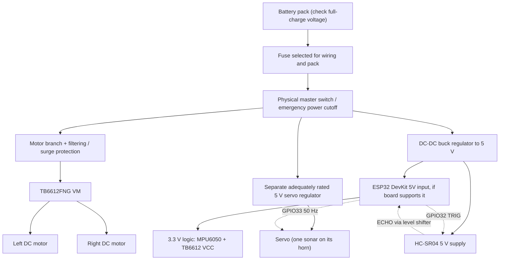

# GyroGuard power distribution and 12 V battery decision

**Design guidance, not hardware validation.** Applicable to the classic ESP32-WROOM-32 + TB6612FNG + MPU6050 + one HC-SR04 on an SG90-class servo.

## Can I connect a 12 V battery?

- **ESP32 DevKit: NO direct 12 V connection** to the 3V3, 5V, USB, or unspecified VIN pin. Use a regulated supply appropriate to the **exact** ESP32 board; the official ESP32-DevKitC V4 supports 5 V at its 5V/GND header, or USB, or 3V3/GND, **one supply method at a time**. Generic third-party DevKit variants must be checked against their board documentation.
- **TB6612FNG VM: conditional.** Toshiba specifies a motor-supply **operating range of 2.5–13.5 V** and a **15 V absolute maximum**, which is *not* an operating target. Nominal 12 V is acceptable only when the **highest actual battery/charger voltage plus switching or braking transients** remains within the operating range. A fully charged 3S Li-ion/LiPo pack reaches **12.6 V**, leaving little transient headroom; **do not assume it is safe without measurement and protective design**. A 4S lithium pack (16.8 V full) is outside the range.
- **Motor rating and current:** use motors appropriate for the applied VM and check **both** their running and stall currents. Toshiba lists **1.0 A/channel in the specified operating conditions** (VM >=4.5 V), **1.2 A/channel as an absolute maximum continuous rating**, and **3.2 A only for a specified 10 ms single pulse**. A motor that draws above the operational rating during ordinary balancing is not suitable for this driver; choose a higher-current driver rather than relying on the brief peak number.
- **TB6612FNG VCC: 3.3 V logic** from the ESP32 board's suitable regulated 3V3 rail; VCC and VM are different pins. Connect all signal/power grounds at a common reference.

## Recommended power tree (conceptual, not a production schematic)

**Shared return:** ESP32, IMU, both regulators, servo, sonar, and motor-driver ground MUST share a signal reference. Route high motor/servo return currents away from sensitive IMU wiring; use suitable decoupling and wiring practices. The physical cutoff should remove motor energy independent of software. It is **not** replaced by GPIO23/STBY or the arm button.

## Voltage and signal table

| Connection | Requirement | Do not do |
|---|---|---|
| Battery + -> driver VM | Within TB6612 usable VM range **throughout operation** | Wire 12 V to ESP32 |
| Battery + -> 5 V buck -> DevKit | Regulated 5 V only if exact DevKit supports 5V pin | Assume every board's VIN tolerance |
| Battery + -> independent 5 V regulator -> SG90 | Regulated 5 V with motor-start/servo-stall current margin | Power servo from ESP32 3V3 |
| TB6612 VCC, MPU6050 | Regulated 3.3 V, verify MPU breakout supply limits | Feed 12 V to logic pins |
| HC-SR04 VCC | Usually regulated 5 V | Feed ECHO directly to ESP32 |
| HC-SR04 ECHO -> GPIO34 | Shift to <=3.3 V; e.g. 1 kΩ from ECHO to GPIO34, 2 kΩ GPIO34 to GND | Apply 5 V to GPIO34 |
| GPIO32 TRIG, GPIO33 servo signal | 3.3 V logic signals; verify peripheral input compatibility | Swap TRIG/ECHO or power pins |

**USB note:** The official DevKitC V4 warns that USB power, the external 5 V header and external 3V3 supply are mutually exclusive. During flashing or serial monitoring, isolate/disconnect external board supply or use verified power-path hardware. Powering the servo from an independent regulator is separate from powering the board and still requires common ground.

## Pre-power checklist

1. Identify exact ESP32 DevKit version, motor voltage/current specifications, battery chemistry/cell count, regulator output/current capability, and physical cutoff.
2. Battery disconnected: check continuity/shorts and confirm VM, VCC, 5V and 3V3 are not cross-wired.
3. With motors disconnected and motor supply isolated, validate 5 V and 3.3 V rails using a meter. Verify the HC-SR04 ECHO level-shifter output remains <=3.3 V.
4. Confirm the servo clears the chassis at 45°, 90°, 135° and does not reset the ESP32 when moving.
5. Run the firmware with wheels raised in a mechanical cradle. Verify `arm_ready`, IMU polarity and both wheel directions; confirm deliberate button disarm and independent power cutoff.
6. Record rail voltages **under load** and at worst expected battery state; inspect transients with suitable instruments. Reassess H-bridge choice if the VM margin cannot be demonstrated.
7. Do not enable `GYROGUARD_AUTONOMY=1` until balancing, encoder-based velocity feedback, collision behavior and fault-stop tests are validated.

See [BENCH_VALIDATION_RECORD.md](BENCH_VALIDATION_RECORD.md) for an evidence record.

## Primary references

- Toshiba, **TB6612FNG datasheet**, operating range and output current: https://toshiba.semicon-storage.com/info/datasheet_en_20141001.pdf?did=10660
- Espressif, **ESP32-DevKitC V4 User Guide**, power supply methods: https://docs.espressif.com/projects/esp-dev-kits/en/latest/esp32/esp32-devkitc/user_guide.html
- Repository pin assignments: [PINOUT.md](PINOUT.md).
